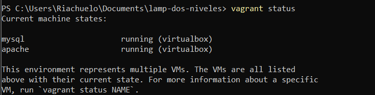
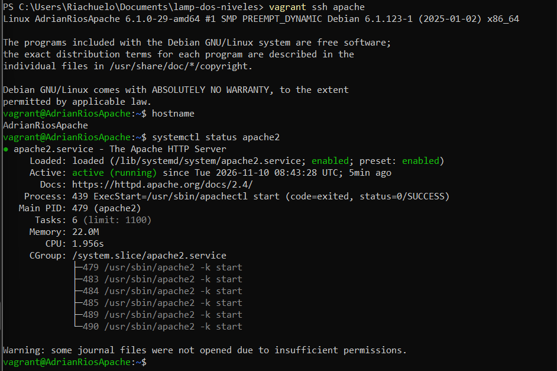
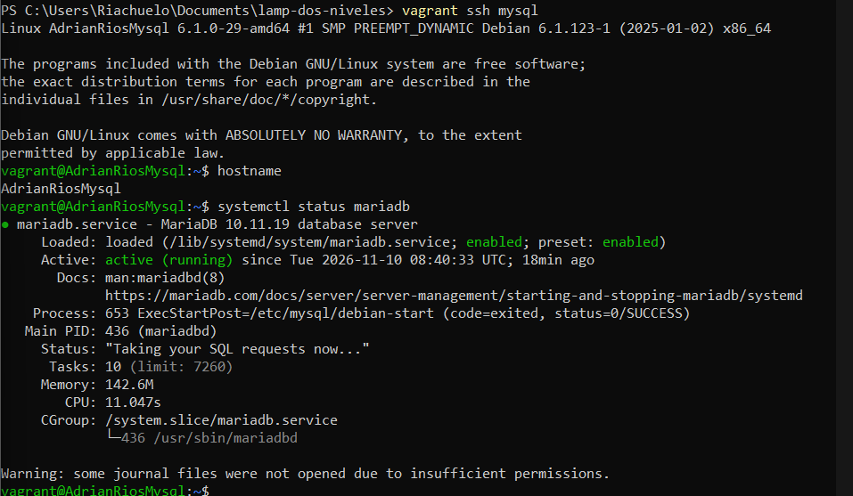
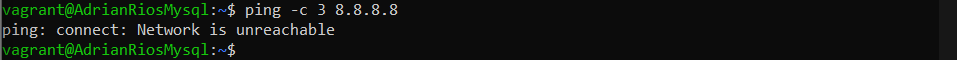
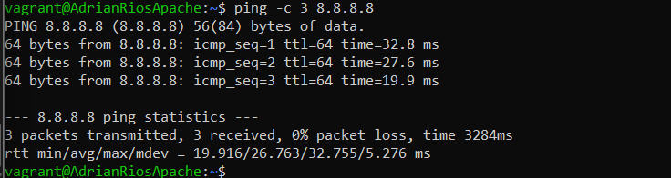
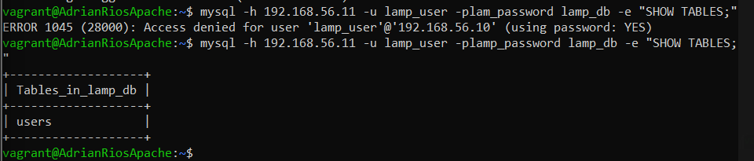
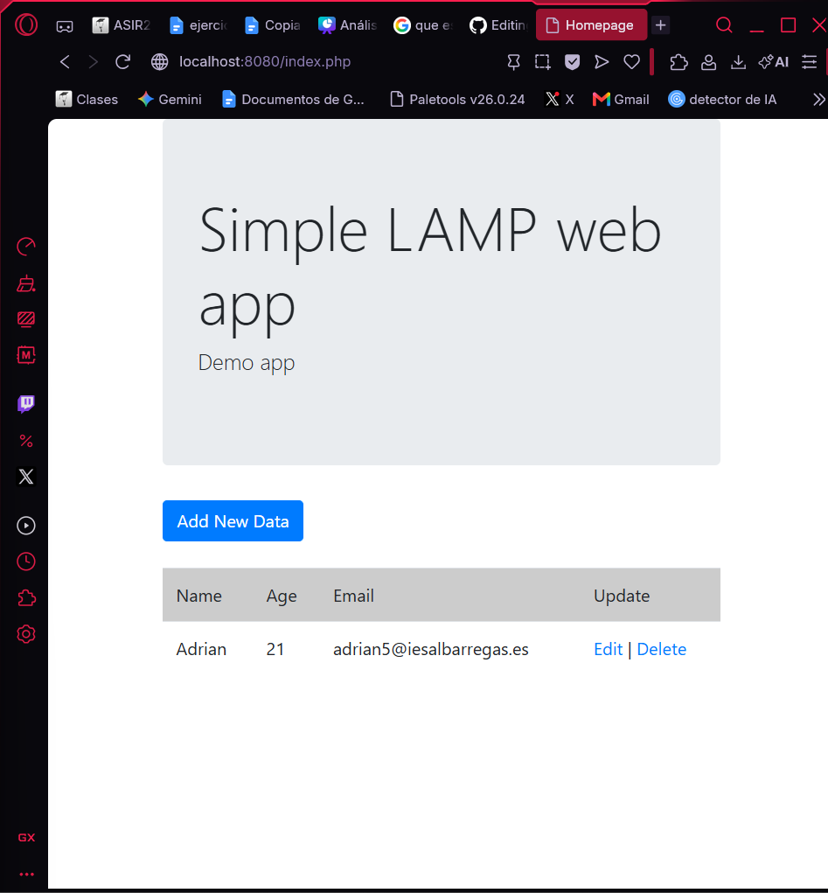

# Pila LAMP en dos niveles con Vagrant

**Alumno:** Adrián Ríos Mendoza
**Módulo:** Implantación de Aplicaciones Web (IAPLW) – 2º ASIR

---

## Índice

1. [Introducción](#1-introducción)
2. [Arquitectura](#2-arquitectura)
3. [Requisitos](#3-requisitos)
4. [Vagrantfile](#4-vagrantfile)
5. [Script de aprovisionamiento de MySQL](#5-script-de-aprovisionamiento-de-mysql)
6. [Script de aprovisionamiento de Apache](#6-script-de-aprovisionamiento-de-apache)
7. [Ajustes en la aplicación](#7-ajustes-en-la-aplicación)
8. [Puesta en marcha](#8-puesta-en-marcha)
9. [Comprobaciones](#9-comprobaciones)
10. [Screencast](#10-screencast)
11. [Conclusión](#11-conclusión)

---

## 1. Introducción

En esta práctica se monta una pila **LAMP** (Linux, Apache, MySQL, PHP) repartida en **dos máquinas virtuales**:

- Una máquina con el **servidor web** (Apache + PHP).
- Otra máquina con el **servidor de base de datos** (MariaDB).

Sobre esta infraestructura se despliega una aplicación web de **gestión de usuarios** que permite añadir, editar y borrar usuarios.

Todo se crea automáticamente con **Vagrant** y **scripts de Bash**.

## 2. Arquitectura

```
            Tu PC (anfitrión)
     http://localhost:8080
                │  (reenvío de puertos 8080 → 80)
                ▼
 ┌──────────────────────────┐        ┌──────────────────────────┐
 │    AdrianRiosApache      │        │     AdrianRiosMysql      │
 │  Apache + PHP            │──────▶│  MariaDB                 │
 │  192.168.56.10           │  3306  │  192.168.56.11           │
 │  NAT: SÍ tiene Internet  │        │  NAT: NO tiene Internet  │
 └──────────────────────────┘        └──────────────────────────┘
```

| Máquina | Hostname | IP privada | Internet | Servicio |
|---|---|---|---|---|
| Web | AdrianRiosApache | 192.168.56.10 | Sí (NAT) | Apache + PHP |
| Base de datos | AdrianRiosMysql | 192.168.56.11 | No | MariaDB |

## 3. Requisitos

- VirtualBox
- Vagrant
- Box `debian/bookworm64` (Debian 12)

## 4. Vagrantfile

```ruby
# -*- mode: ruby -*-
# vi: set ft=ruby :

# Pila LAMP en dos niveles
#   - AdrianRiosMysql  -> servidor de base de datos (SIN Internet)
#   - AdrianRiosApache -> servidor web Apache + PHP (CON Internet por NAT)

Vagrant.configure("2") do |config|

  # Box de Debian 12 (Bookworm) para las dos máquinas
  config.vm.box = "debian/bookworm64"

  # ---------- MÁQUINA 1: BASE DE DATOS ----------
  # Se define primero para que arranque antes que Apache
  config.vm.define "mysql" do |mysql|
    mysql.vm.hostname = "AdrianRiosMysql"

    # Red privada: solo se comunica con la máquina Apache
    mysql.vm.network "private_network", ip: "192.168.56.11"

    mysql.vm.provider "virtualbox" do |vb|
      vb.name   = "AdrianRiosMysql"
      vb.memory = 1024
    end

    # Aprovisionamiento: instala MariaDB y crea la base de datos
    mysql.vm.provision "shell", path: "provision_mysql.sh"

    # Cada vez que arranca, se borra la ruta por defecto
    # para que la máquina NO tenga salida a Internet
    mysql.vm.provision "shell", run: "always",
      inline: "ip route del default 2>/dev/null || true"
  end

  # ---------- MÁQUINA 2: SERVIDOR WEB ----------
  config.vm.define "apache" do |apache|
    apache.vm.hostname = "AdrianRiosApache"

    # Red privada para hablar con la base de datos
    apache.vm.network "private_network", ip: "192.168.56.10"

    # Reenvío de puertos: localhost:8080 (tu PC) -> puerto 80 (Apache)
    apache.vm.network "forwarded_port", guest: 80, host: 8080

    apache.vm.provider "virtualbox" do |vb|
      vb.name   = "AdrianRiosApache"
      vb.memory = 1024
    end

    # Aprovisionamiento: instala Apache + PHP y despliega la aplicación
    apache.vm.provision "shell", path: "provision_apache.sh"
  end

end

```

**Explicación:**

- `config.vm.box = "debian/bookworm64"`: las dos máquinas usan Debian 12.
- `config.vm.define "mysql"` / `"apache"`: define cada máquina. MySQL va primero para que la base de datos esté lista antes que la web.
- `vm.hostname`: el nombre de cada máquina.
- `private_network`: red interna para que las dos máquinas se comuniquen.
- `forwarded_port guest: 80, host: 8080`: al entrar en `localhost:8080` desde el PC, se llega al Apache de la máquina.
- `vm.provision "shell", path: ...`: ejecuta el script de aprovisionamiento de cada máquina.
- `run: "always"` con `ip route del default`: en cada arranque se quita la puerta de enlace de la máquina MySQL, así nunca tiene salida a Internet.

## 5. Script de aprovisionamiento de MySQL

```bash
#!/bin/bash
# Aprovisionamiento de la máquina de base de datos (AdrianRiosMysql)

# Muestra cada orden por pantalla y para si alguna falla
set -ex

# ----- Variables -----
DB_NAME=lamp_db
DB_USER=lamp_user
DB_PASSWORD=lamp_password
APACHE_IP=192.168.56.10

# 1. Actualizar la lista de paquetes
apt-get update

# 2. Instalar MariaDB (en Debian 12 sustituye a MySQL)
apt-get install -y mariadb-server

# 3. Permitir conexiones desde otras máquinas
#    Por defecto MariaDB solo escucha en 127.0.0.1
sed -i 's/^bind-address.*/bind-address = 0.0.0.0/' /etc/mysql/mariadb.conf.d/50-server.cnf

# 4. Reiniciar MariaDB para aplicar el cambio
systemctl restart mariadb

# 5. Crear la base de datos y la tabla de la aplicación
mysql -u root <<EOF
DROP DATABASE IF EXISTS $DB_NAME;
CREATE DATABASE $DB_NAME CHARSET utf8mb4;
USE $DB_NAME;

CREATE TABLE users (
  id INT UNSIGNED AUTO_INCREMENT PRIMARY KEY,
  name VARCHAR(100) NOT NULL,
  age INT UNSIGNED NOT NULL,
  email VARCHAR(100) UNIQUE NOT NULL
) ENGINE=InnoDB DEFAULT CHARSET=utf8;
EOF

# 6. Crear el usuario que usará la aplicación
#    Solo puede conectarse desde la IP de la máquina Apache
mysql -u root <<EOF
DROP USER IF EXISTS '$DB_USER'@'$APACHE_IP';
CREATE USER '$DB_USER'@'$APACHE_IP' IDENTIFIED BY '$DB_PASSWORD';
GRANT ALL PRIVILEGES ON $DB_NAME.* TO '$DB_USER'@'$APACHE_IP';
FLUSH PRIVILEGES;
EOF

# 7. Quitar la puerta de enlace para que la máquina NO tenga Internet
#    (el Vagrantfile lo repite en cada arranque)
ip route del default || true

```

**Explicación:**

| Paso | Orden | Qué hace |
|---|---|---|
| — | `set -ex` | Muestra cada orden y para el script si alguna falla. |
| 1 | `apt-get update` | Actualiza la lista de paquetes. |
| 2 | `apt-get install -y mariadb-server` | Instala MariaDB (en Debian 12 sustituye a MySQL). |
| 3 | `sed -i ... bind-address = 0.0.0.0` | Hace que MariaDB acepte conexiones desde otras máquinas, no solo desde sí misma. |
| 4 | `systemctl restart mariadb` | Reinicia el servicio para aplicar el cambio. |
| 5 | `CREATE DATABASE` / `CREATE TABLE` | Crea la base de datos `lamp_db` y la tabla `users` que usa la aplicación. |
| 6 | `CREATE USER` / `GRANT` | Crea el usuario `lamp_user`, que solo puede conectarse desde la IP de Apache (192.168.56.10). |
| 7 | `ip route del default` | Borra la puerta de enlace: la máquina se queda sin Internet. |

## 6. Script de aprovisionamiento de Apache

```bash
#!/bin/bash
# Aprovisionamiento de la máquina web (AdrianRiosApache)

# Muestra cada orden por pantalla y para si alguna falla
set -ex

# ----- Variables (deben coincidir con provision_mysql.sh) -----
DB_HOST=192.168.56.11
DB_NAME=lamp_db
DB_USER=lamp_user
DB_PASSWORD=lamp_password

# 1. Actualizar la lista de paquetes
apt-get update

# 2. Instalar Apache, PHP, el conector de PHP con MySQL y git
apt-get install -y apache2 php libapache2-mod-php php-mysql git

# 3. Descargar la aplicación de GitHub
rm -rf /tmp/iaw-practica-lamp
git clone https://github.com/josejuansanchez/iaw-practica-lamp.git /tmp/iaw-practica-lamp

# 4. Borrar la página por defecto de Apache y copiar la aplicación
rm -f /var/www/html/index.html
cp -r /tmp/iaw-practica-lamp/src/* /var/www/html/

# 5. Ajustar config.php con los datos de la base de datos
sed -i "s/localhost/$DB_HOST/"              /var/www/html/config.php
sed -i "s/database_name_here/$DB_NAME/"     /var/www/html/config.php
sed -i "s/username_here/$DB_USER/"          /var/www/html/config.php
sed -i "s/password_here/$DB_PASSWORD/"      /var/www/html/config.php

# 6. Dar los ficheros al usuario de Apache
chown -R www-data:www-data /var/www/html

# 7. Reiniciar Apache para aplicar los cambios
systemctl restart apache2
```

**Explicación:**

| Paso | Orden | Qué hace |
|---|---|---|
| — | `set -ex` | Muestra cada orden y para el script si alguna falla. |
| 1 | `apt-get update` | Actualiza la lista de paquetes. |
| 2 | `apt-get install -y apache2 php libapache2-mod-php php-mysql git` | Instala Apache, PHP, el módulo que une PHP con Apache, la extensión para conectar PHP con MySQL y git. |
| 3 | `git clone ...` | Descarga la aplicación de GitHub. |
| 4 | `rm index.html` y `cp -r src/*` | Borra la página por defecto de Apache y copia la aplicación a `/var/www/html`. |
| 5 | `sed -i ...` en `config.php` | Cambia los datos de conexión de la aplicación (ver apartado 7). |
| 6 | `chown -R www-data:www-data` | Hace que los ficheros pertenezcan al usuario de Apache. |
| 7 | `systemctl restart apache2` | Reinicia Apache para aplicar los cambios. |

## 7. Ajustes en la aplicación

La aplicación trae un fichero `config.php` con datos de ejemplo. Hay que cambiarlos para que se conecte a nuestra base de datos, que está en **otra máquina**:

| Constante | Valor original | Valor nuevo |
|---|---|---|
| `DB_HOST` | `localhost` | `192.168.56.11` |
| `DB_NAME` | `database_name_here` | `lamp_db` |
| `DB_USER` | `username_here` | `lamp_user` |
| `DB_PASSWORD` | `password_here` | `lamp_password` |

El cambio importante es `DB_HOST`: con `localhost` la aplicación buscaría la base de datos en la propia máquina Apache, pero está en la máquina MySQL.

Resultado:

```php
define('DB_HOST', '192.168.56.11');
define('DB_NAME', 'lamp_db');
define('DB_USER', 'lamp_user');
define('DB_PASSWORD', 'lamp_password');
```

## 8. Puesta en marcha

Desde la carpeta del proyecto:

```bash
vagrant up
```

Después se abre en el navegador:

```
http://localhost:8080
```

Otros comandos útiles:

```bash
vagrant ssh apache     # entrar a la máquina web
vagrant ssh mysql      # entrar a la máquina de base de datos
vagrant halt           # apagar las máquinas
vagrant destroy -f     # borrar las máquinas
```

## 9. Comprobaciones

### 9.1. Las dos máquinas están en marcha

`vagrant status`



### 9.2. Apache funcionando en AdrianRiosApache

`systemctl status apache2`



### 9.3. MariaDB funcionando en AdrianRiosMysql

`systemctl status mariadb`



### 9.4. MariaDB escucha conexiones externas

`sudo ss -tlnp | grep 3306`


### 9.5. La máquina MySQL NO tiene Internet

`ping -c 3 8.8.8.8` → debe fallar.



### 9.6. La máquina Apache SÍ tiene Internet

`ping -c 3 8.8.8.8` → debe responder.



### 9.7. Apache se conecta a la base de datos

Desde AdrianRiosApache:

`mysql -h 192.168.56.11 -u lamp_user -p lamp_db`



### 9.8. La aplicación funciona

`http://localhost:8080` desde el navegador del PC.



## 10. Screencast

Vídeo del funcionamiento de la aplicación (añadir, editar y borrar usuarios):

[Ver screencast](screencast/screencast.mp4)

## 11. Conclusión

Separar el servidor web y la base de datos en dos máquinas mejora la **seguridad**, porque la base de datos no tiene acceso a Internet y solo acepta conexiones desde el servidor web. Gracias a **Vagrant** y a los **scripts de Bash**, todo el entorno se puede crear de nuevo con un solo comando (`vagrant up`).
